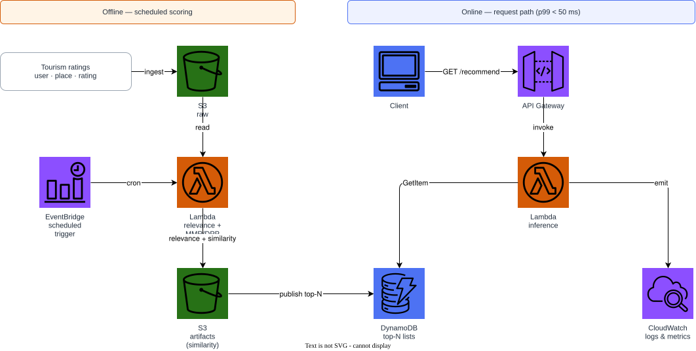
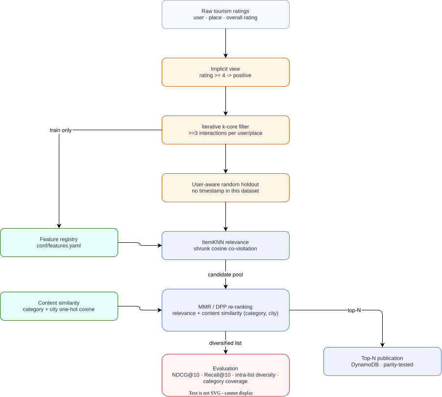

# Indonesia Tourism Diversity Recommender

Deterministic diversity re-ranking — **Maximal Marginal Relevance (MMR)**
and a **greedy Determinantal Point Process (DPP)** — layered on top of a
classical collaborative relevance score, for Indonesia tourism destination
recommendation. No neural network, no learned re-ranking policy: both
diversification strategies are closed-form or greedy combinatorial
algorithms over an explicit relevance score and an explicit content
similarity matrix.

---

## Why re-ranking, not another scorer

A plain relevance ranking over co-visited destinations tends to cluster
around one dominant category (e.g. five beaches in a row). This project
keeps the relevance scorer itself simple — a shrunk-cosine item-item kNN —
and puts the interesting work in what happens *after* scoring:

- **MMR** greedily picks, at each step, the candidate maximising
  $\lambda \cdot \text{relevance} - (1-\lambda) \cdot \max(\text{similarity to already-selected})$.
- **DPP** instead models the *whole list* jointly: the selected subset's
  quality is $\det(L_S)$ for a kernel $L$ that is large exactly when items
  are both individually relevant and mutually dissimilar. Exact MAP
  inference is NP-hard, so this uses the standard fast greedy
  approximation (Chen, Zhang and Zhou, 2018).

Both operate on the same content similarity matrix (destination category
and city), so the comparison between them isolates the re-ranking strategy,
not the underlying data.

---

## Dataset

[Indonesia Tourism Destination](https://www.kaggle.com/datasets/aprabowo/indonesia-tourism-destination)
(Kaggle ref `aprabowo/indonesia-tourism-destination`): ratings (1–5 scale)
from users over destinations across five Indonesian cities, each tagged
with a category. There is no event timestamp, so — like
`restaurant-ease-recommender` — evaluation uses a **user-aware random
holdout**.

---

## Quick start

```bash
python -m venv .venv && source .venv/bin/activate
pip install -e ".[dev]"

# Synthetic fixture with the same schema (no Kaggle account needed)
python scripts/download_data.py --synthetic

# Build the point-in-time feature tables
python scripts/build_features.py

# Train, evaluate (reports both ranking quality and list diversity), recommend
python -m recommender.cli train
python -m recommender.cli evaluate
python -m recommender.cli recommend --user-id 1 --k 10 --strategy mmr
python -m recommender.cli recommend --user-id 1 --k 10 --strategy dpp
```

The real dataset (requires `KAGGLE_USERNAME`/`KAGGLE_KEY`):

```bash
python scripts/download_data.py --kaggle
```

---

## Architecture

### AWS deployment



### Recommendation flow



Both diagrams are editable: [`docs/aws-architecture.drawio`](docs/aws-architecture.drawio)
and [`docs/recommendation-architecture.drawio`](docs/recommendation-architecture.drawio).
Regenerate them with `scripts/generate_diagrams.py`.

---

## Models

| Model | Mechanism | Notes |
|---|---|---|
| `RelevanceOnly` | shrunk cosine item-item co-visitation | The baseline the two re-rankers are compared against |
| `MMR` | greedy, pairwise relevance/diversity trade-off | Single scalar λ controls the trade-off |
| `DPP` | greedy MAP over a quality-diversity kernel | Models the selected set jointly, not pairwise |
| `Popularity` | global interaction count | Non-personalised floor |

---

## Feature engineering

Features are declared in [`conf/features.yaml`](conf/features.yaml). User
statistics are fitted strictly on the training partition; destination
category and city are read directly from the catalogue and double as the
descriptors the content similarity matrix is built from, so they carry no
collaborative-label signal.

| Feature | Family | Fit scope |
|---|---|---|
| `user_activity_count` | user | train_only |
| `user_mean_rating` | user | train_only |
| `item_popularity_rank` | item | train_only |
| `item_category` | item | catalogue |
| `item_city` | text | catalogue |

`tests/test_features_leakage.py` asserts user features never include a user
absent from training and that catalogue columns match the raw catalogue
verbatim. `tests/test_features_parity.py` asserts the published top-N
payload matches the ranking the offline model actually produced.

---

## Evaluation

User-aware random holdout (10% validation / 20% test per eligible user).
Reported on both ranking quality and list quality:

| Model | NDCG@10 | Recall@10 | Intra-list diversity | Category coverage |
|---|---:|---:|---:|---:|
| RelevanceOnly | 0.1139 | 0.2632 | 0.8271 | 0.5211 |
| MMR (λ=0.5) | 0.0863 | 0.1842 | 0.8837 | 0.6000 |
| DPP | 0.0875 | 0.1842 | 0.8815 | 0.6000 |
| Popularity | 0.1287 | 0.3158 | 0.8658 | 0.5526 |

Both re-rankers trade ranking quality for a measurable gain in diversity
and category coverage over the plain relevance baseline — the expected
signature of deterministic diversification. Numbers are from the synthetic
CI fixture; the real dataset's genuine category/city structure is expected
to make the trade-off more pronounced.

---

## Infrastructure

```bash
docker compose up -d
terraform -chdir=terraform init
terraform -chdir=terraform validate
terraform -chdir=terraform apply -auto-approve
terraform -chdir=terraform destroy -auto-approve
docker compose down
```

Terraform targets the local Floci AWS emulator at `http://localhost:4566`
with dummy credentials, so the default path costs nothing and needs no AWS
account. Set `use_floci = false` to point the same resources at real AWS.

### Cost and cleanup

Floci is a local emulator and costs nothing. Against real AWS, the billed
resources are an S3 bucket (versioned, lifecycle-managed), a
pay-per-request DynamoDB table, one small Lambda, and an EventBridge rule —
all destroyed by `terraform destroy -auto-approve`. Nothing here runs an
always-on compute instance.

---

## Paper

Methodology (MMR and DPP formulations, kernel construction) and results are
in [`paper/main.pdf`](paper/main.pdf).

```bash
make -C paper docker   # build the PDF in a container
```

---

## License and data

Code is MIT licensed. The dataset is distributed by its Kaggle maintainer
under its own terms and is **not** redistributed here;
`scripts/download_data.py` fetches it on demand or generates a synthetic
fixture with the same schema.
